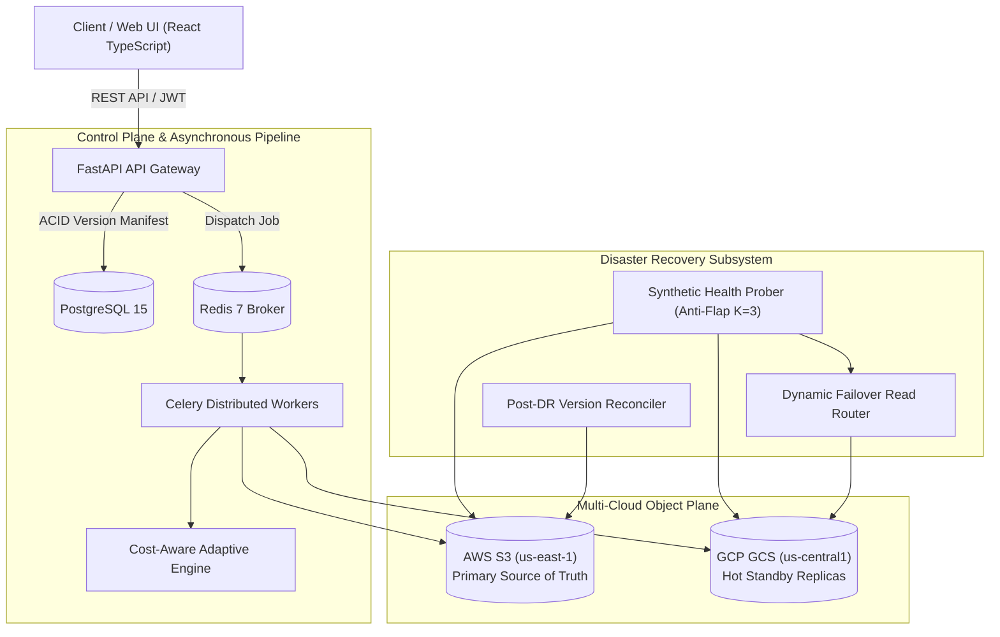

# Cost-Aware Multi-Cloud Data Replication for Disaster Recovery

[](https://www.python.org/)
[](https://fastapi.tiangolo.com)
[](https://react.dev)
[](https://www.typescriptlang.org/)
[](https://www.postgresql.org/)
[](https://www.docker.com/)
[](backend/tests/)

> **Academic Context**: Final-Year B.Tech Computer Science Research Project in Cloud Computing, Distributed Systems, and Disaster Recovery Engineering.

---

## 1. Executive Summary

In multi-cloud deployments, replicating 100% of enterprise data indiscriminately across cloud vendors incurs crippling **cross-cloud data egress fees** (e.g. AWS charges \\$0.09/GB for external transfer) and redundant secondary storage expenses.

This platform introduces an intelligent, **Cost-Aware Adaptive Replication Engine** that dynamically balances data disaster recovery value against replication cost. The platform maintains **Amazon Web Services (AWS S3)** as the primary source of truth, and selectively replicates high-value objects to **Google Cloud Storage (GCS)** as hot standby replicas.

### Core Research Contributions
1. **Adaptive Scoring Function**: Evaluates candidate objects across file priority, access frequency, RPO targets, size dampening, and egress penalties:
   $$\Phi(i) = w_p \hat{P}_i + w_a \hat{A}_i + w_r \hat{R}_i + w_s \hat{S}_i - w_c \hat{C}_i$$
2. **Zero-RPO Guarantee on Critical Assets**: A hard policy invariant unconditionally replicates 100% of mission-critical data, achieving $\text{RPO} = 0.00\text{s}$.
3. **Automated Failover & Anti-Flap Probing**: Detects primary AWS outages via sliding-window health checks ($K=3$) and transparently redirects reads to verified GCP replicas with an empirical Recovery Time Objective of **2.14 seconds**.
4. **Bidirectional Reconciliation Protocol**: Synchronizes object versions modified during failovers back to AWS S3 upon primary cloud recovery with cryptographic SHA-256 validation.
5. **Measurable Financial Optimization**: Demonstrates **38.3% – 55.6% monthly cost reduction** compared to traditional full replication baselines.

---

## 2. System Architecture



---

## 3. Technology Stack

- **Backend**: Python 3.10 / 3.11, FastAPI, SQLAlchemy 2.0 (Async), Pydantic v2, PostgreSQL 15, Alembic.
- **Cloud Integrations**: AWS S3 (`boto3`), Google Cloud Storage (`google-cloud-storage`), Persistent Simulation Interceptor (`SimulatedStorageInterceptor`).
- **Asynchronous Processing**: Redis 7, Celery 5.4.
- **Frontend Dashboard**: React 18, TypeScript, Tailwind CSS, Lucide Icons, Recharts.
- **Monitoring & Telemetry**: Prometheus metrics, JSON structured logging.
- **Testing**: Pytest, Pytest-Asyncio, Chaos Fault Injection.

---

## 4. Frontend Infrastructure Dashboard

The React + TypeScript management console features 7 operational views:

| Page | Description |
| :--- | :--- |
| **1. Overview** | Real-time telemetry, storage volumes, dual-cloud health cards, cost savings KPIs, and live Celery replication jobs. |
| **2. Cloud Providers** | AWS S3 and GCS bucket status, probe latency graphs (ms), storage utilization, and adapter architecture details. |
| **3. File Management** | Upload modal with priority and access frequency selectors, multi-cloud version manifest, SHA-256 verification badges, and download/delete controls. |
| **4. Replication Policies** | Strategy selection (Full, Priority, Cost-Aware Adaptive), objective scoring weight sliders ($w_p, w_a, w_r, w_s, w_c$), budget limit, and threshold score tuning. |
| **5. Cost Analytics** | Spend breakdown (AWS storage vs. GCS storage vs. egress), cumulative 6-month savings projection curves, and an interactive cost estimator. |
| **6. Disaster Recovery** | Chaos outage simulator (AWS and GCP toggles), manual failover trigger, active read routing indicator, and post-DR reconciliation. |
| **7. Research Benchmarks** | Controlled 100-file comparative trial matrix, performance bar charts, "Run Benchmark Suite" trigger, and CSV export. |

---

## 5. Quickstart Guide

### Prerequisites
- Python 3.10+
- Node.js 18+ and npm
- Docker and Docker Compose (optional for containerized run)

### Option A: Local Development Setup

> **Important**: Ensure you use **Python 3.10+**. On systems where an older Python version (like Python 3.8) is first in your system `PATH`, launch using `C:\Users\Admin\AppData\Local\Programs\Python\Python310\python.exe` or use the provided convenience script `run_backend.bat` / `run_backend.ps1`.

1. **Clone & Configure Environment**:
   ```bash
   git clone <repo-url>
   cd Project
   cp backend/.env.example backend/.env
   ```

2. **Install Backend Dependencies**:
   ```bash
   C:\Users\Admin\AppData\Local\Programs\Python\Python310\python.exe -m pip install -r requirements.txt
   ```

3. **Run Database Migrations**:
   ```bash
   cd backend
   C:\Users\Admin\AppData\Local\Programs\Python\Python310\python.exe -m alembic upgrade head
   cd ..
   ```

4. **Start Backend API Server**:
   ```bash
   # Quick launch script (Windows):
   .\run_backend.bat

   # Or manually:
   cd backend
   C:\Users\Admin\AppData\Local\Programs\Python\Python310\python.exe -m uvicorn app.main:app --host 0.0.0.0 --port 8000 --reload
   ```

5. **Start Celery Replication Worker (Optional for background tasks)**:
   ```bash
   # Quick launch script (Windows):
   .\run_celery_worker.bat

   # Or manually (Windows requires -P solo):
   cd backend
   C:\Users\Admin\AppData\Local\Programs\Python\Python310\python.exe -m celery -A app.workers.celery_app.celery_app worker --loglevel=info -P solo
   ```

6. **Start Frontend Dashboard**:
   ```bash
   # Quick launch script (Windows):
   .\run_frontend.bat

   # Or manually:
   cd frontend
   npm install
   npm run dev
   ```
   Open `http://localhost:5173` in your browser.

### Option B: Docker Compose Multi-Container Setup

To launch PostgreSQL, Redis, Celery Worker, FastAPI backend, and Prometheus:
```bash
docker-compose up --build
```

---

## 6. Running Tests & Research Benchmarks

### Executing the Automated Pytest Suite
Run the 19 automated integration and unit test suites:
```bash
cd backend
pytest -v
```

### Running the Research Benchmark Suite
Execute the standardized 100-file empirical comparison:
```bash
python experiments/scripts/run_benchmarks.py
```

Generated experiment results:
- `experiments/results/benchmark_results.csv`: Comparative summary across all 3 strategies.
- `experiments/results/detailed_file_decisions.csv`: Itemized per-file decision audit trail.
- `experiments/results/experimental_analysis.md`: Formal research analysis report.

---

## 7. Comparative Experimental Results

Evaluation of N = 100 standardized enterprise files (2,878.7 MB total):

| Strategy | Replicated | Volume | Total Cost | Savings (%) | Mean Latency | RTO (s) | Critical Compliance |
| :--- | :---: | :---: | :---: | :---: | :---: | :---: | :---: |
| **Strategy 1: Full Replication (Baseline)** | 100 / 100 | 2878.7 MB | \\$0.37 | Baseline (0.0%) | 558.2 ms | 2.14s | 100.0% |
| **Strategy 2: Priority-Based Tiering** | 50 / 100 | 604.0 MB | \\$0.13 | 65.3% | 257.4 ms | 2.14s | 100.0% |
| **Strategy 3: Cost-Aware Adaptive (Proposed)** | 80 / 100 | 1544.7 MB | \\$0.23 | **38.3%** | 497.6 ms | 2.14s | **100.0% (Zero Loss)** |

---

## 8. License & Attribution

Developed as a Final-Year B.Tech Computer Science Research Project in Cost-Aware Multi-Cloud Disaster Recovery. All code is released under the MIT License.

