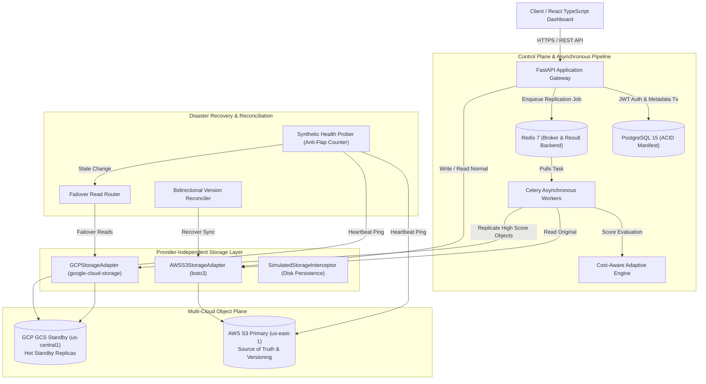

# System Architecture: Cost-Aware Multi-Cloud Data Replication for Disaster Recovery

## 1. High-Level Architecture Overview

The platform implements an intermediate-to-advanced, enterprise-grade multi-cloud disaster recovery system. The architecture maintains **Amazon Web Services (AWS S3)** as the primary source of truth during normal operations, and asynchronously replicates high-value objects to **Google Cloud Storage (GCS)** as hot standby disaster recovery replicas.

---

## 2. Core Architectural Subsystems

### A. Backend API Service (FastAPI)
- **Framework**: FastAPI (Python 3.10 / 3.11) with Uvicorn ASGI server.
- **Security**: OAuth2 with JWT bearer tokens (`pyjwt`), role-based access control (`admin`, `operator`, `viewer`), and password hashing with `bcrypt`.
- **Validation**: Strict Pydantic v2 schemas with `ConfigDict(from_attributes=True)`.
- **Database Connection**: Asynchronous SQLAlchemy 2.0 with connection pooling and PostgreSQL transactions.

### B. Provider-Independent Cloud Storage Abstraction Layer
The replication engine and API never bind directly to cloud provider SDKs. All operations are mediated through the abstract interface `ICloudStorageProvider`:
1. **`AWSS3StorageAdapter`**: Integrates with Amazon Web Services S3 via `boto3`. Implements S3 object versioning (`aws_version_id`), custom user metadata headers (`x-amz-meta-sha256`), and multi-part upload streaming.
2. **`GCPStorageAdapter`**: Integrates with Google Cloud Storage via `google-cloud-storage`. Integrates service account credentials (`serviceAccount.json`), tracks GCS integer generation numbers (`gcp_generation_id`), and validates cryptographic hashes.
3. **`SimulatedStorageInterceptor`**: Local filesystem interceptor providing full versioning emulation, deterministic chaos fault injection (latency delays, simulated outages), and tamper detection for isolated development and continuous integration.

### C. Asynchronous Replication Engine
- **Decoupled Ingest**: File uploads write to primary AWS S3 synchronously, record metadata in PostgreSQL, and dispatch asynchronous replication tasks via Celery without blocking client responses.
- **Reliability & Resilience**:
  - Idempotency guard via unique MD5 / UUID task keys.
  - Celery dead-letter queue and exponential retry backoff ($2^n \times 500\text{ms}$).
  - End-to-end cryptographic SHA-256 verification before replica registration.
  - Automatic cost and latency telemetry accounting per replication event.

### D. Disaster Recovery Manager
- **Anti-Flap Health Probing**: Periodically evaluates provider read/write endpoints using a sliding window consecutive failure counter ($N = 3$) to eliminate false alarms from transient network spikes.
- **Automated Failover Router**: When AWS S3 is detected as degraded or unavailable, all read queries are dynamically and transparently redirected to healthy GCP GCS replicas without application downtime.
- **Bidirectional Reconciliation**: Upon primary AWS recovery, the reconciler compares object manifests, detects modifications made during failover, replicates missing generations back to AWS S3, and restores primary routing.

---

## 3. Technology Matrix

| Layer | Component | Specification |
| :--- | :--- | :--- |
| **Backend Runtime** | Python | 3.10 / 3.11 |
| **API Framework** | FastAPI | High-performance asynchronous REST API |
| **Database** | PostgreSQL | Relational metadata store, version manifests, ACID transactions |
| **ORM / Migration** | SQLAlchemy 2.0 / Alembic | Async engine, declarative models, schema migration scripts |
| **Message Broker** | Redis 7 | Celery broker, health cache, and task result backend |
| **Task Queue** | Celery 5.4 | Distributed asynchronous worker processing |
| **Cloud Primary** | AWS S3 | `boto3` official SDK, us-east-1 |
| **Cloud Secondary**| GCP GCS | `google-cloud-storage` official SDK, us-central1 |
| **Frontend UI** | React 18, TypeScript, Tailwind | Modern cloud infrastructure management dashboard |
| **Data Viz** | Recharts | Real-time cross-cloud latency, spend, and RTO/RPO charts |
| **Containerization**| Docker & Docker Compose | Multi-container reproducible runtime |

