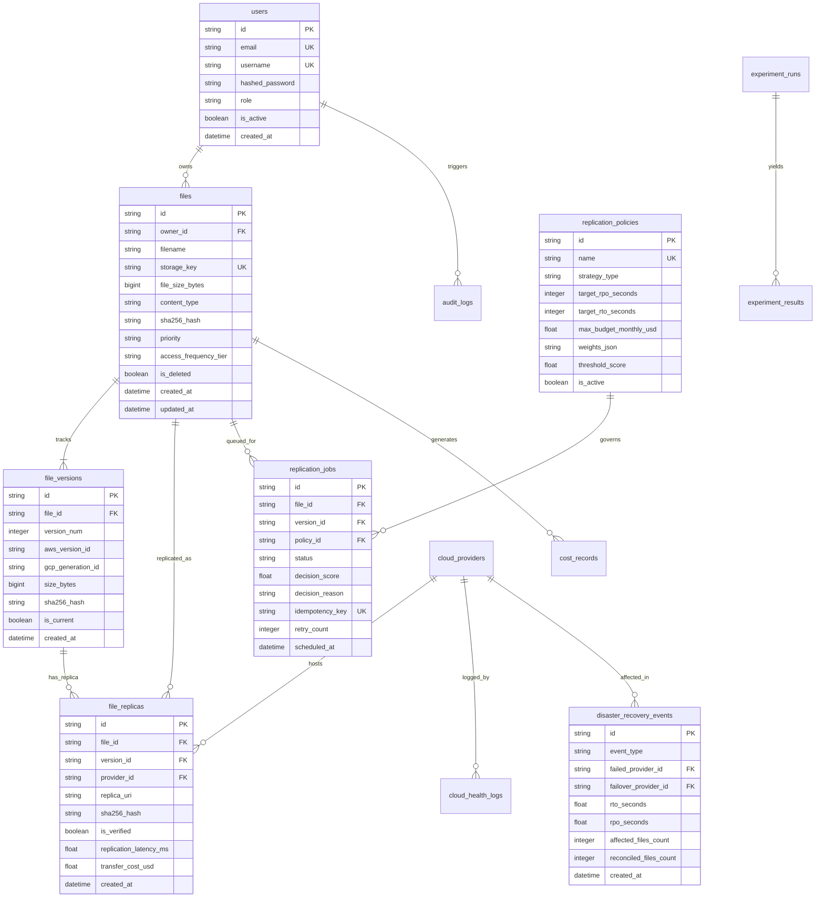

# Relational Database Schema Design (PostgreSQL)

## 1. Entity-Relationship Overview

The platform uses PostgreSQL 15 as its ACID-compliant source of truth for file metadata, multi-cloud version manifests, asynchronous task tracking, and disaster recovery audit events.

---

## 2. Table Specifications & Indexes

### 1. `users`
- Stores system operators and research evaluators with bcrypt passwords.
- **Indexes**: `ix_users_username` (unique), `ix_users_email` (unique).

### 2. `cloud_providers`
- Stores endpoints and configurations for primary AWS S3 and secondary GCP GCS.
- **Indexes**: `ix_cloud_providers_name` (unique).

### 3. `files`
- Canonical metadata manifest for every uploaded object.
- **Indexes**: `ix_files_storage_key` (unique), `ix_files_owner_id`, `ix_files_priority`.

### 4. `file_versions`
- Implements object version history tracking both `aws_version_id` (string) and `gcp_generation_id` (integer string).
- **Constraints**: Composite unique index on `(file_id, version_num)`.

### 5. `file_replicas`
- Secondary cloud replicas verified with cryptographic SHA-256 hashes.
- **Indexes**: `ix_file_replicas_file_id`, `ix_file_replicas_provider_id`, `ix_file_replicas_is_verified`.

### 6. `replication_policies`
- Governs policy thresholds, target RTO/RPO SLA constraints, and JSON weight configurations.
- **Fields**: `threshold_score`, `max_budget_monthly_usd`, `weights_json`.

### 7. `replication_jobs`
- Asynchronous task ledger with idempotency keys to prevent duplicate Celery worker execution.
- **Indexes**: `ix_replication_jobs_idempotency_key` (unique), `ix_replication_jobs_status`.

### 8. `disaster_recovery_events`
- Immutable event audit log of failover triggers, chaos simulations, RTO/RPO metrics, and post-recovery reconciliations.
- **Indexes**: `ix_dr_events_event_type`, `ix_dr_events_created_at`.

### 9. `cost_records`
- Audited accounting of AWS storage, GCP storage, egress transfer charges, and API fees.

### 10. `experiment_runs` & `experiment_results`
- Persistent benchmark history comparing Full, Priority, and Cost-Aware Adaptive strategies.

### 11. `audit_logs`
- Regulatory audit trail capturing user IP addresses, actions, and timestamps.

---

## 3. Database Migrations
Migrations are maintained via **Alembic**:
- Initial migration script: `backend/alembic/versions/2026_11_04_1749-6081e039d877_initial_schema.py`
- Executable via: `alembic upgrade head`

